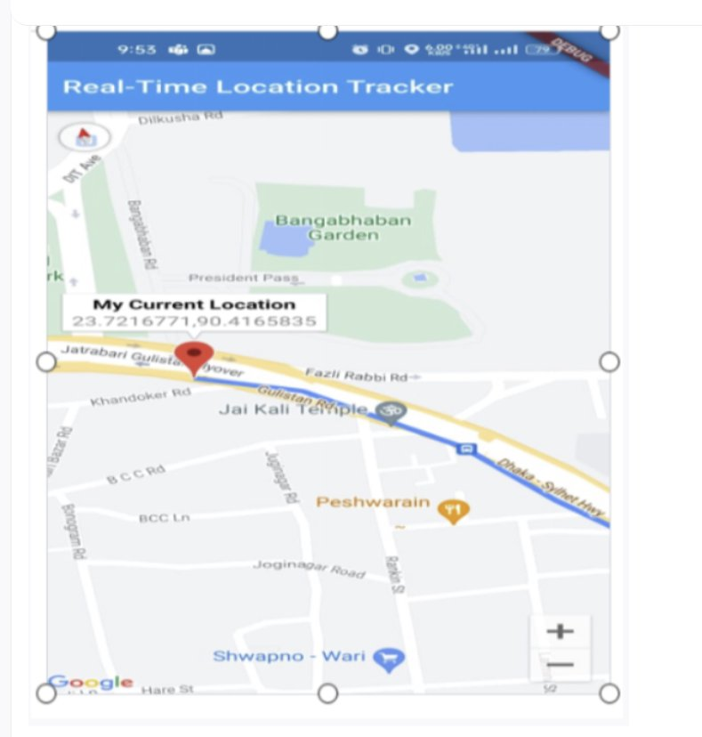
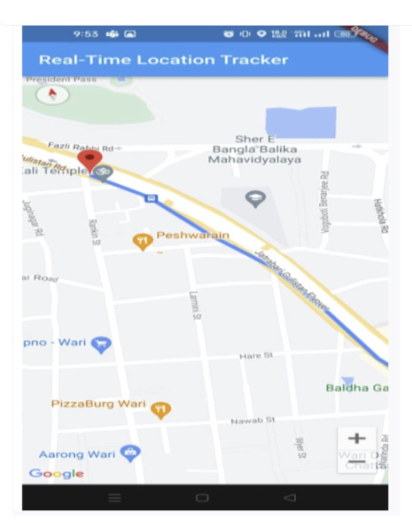
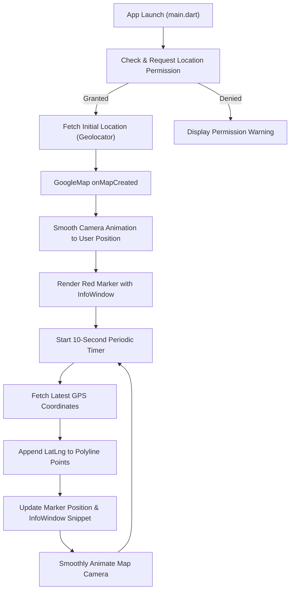

# Real-Time Location Tracker 📍

A Flutter mobile application demonstrating real-time GPS tracking, smooth Google Maps camera animations, periodic position updates, dynamic polyline route tracking, and custom marker info windows using **Google Maps Flutter** and **Geolocator**.

---

## 📱 Output Screenshots

| Real-Time Location with Info Window | Polyline Tracking along Path |
|:---:|:---:|
|  |  |
| *Marker with "My Current Location" & Lat/Lng snippet* | *Dynamic blue polyline tracing movements* |

---

## 📋 Assignment Requirements & Implementation Checklist

| Task | Requirement | Status | Description |
|:---:|:---|:---:|:---|
| **1** | **Automatic Map Animation** | ✅ Completed | On launch and initial location acquisition, the Google Map view smoothly animates the camera (`CameraUpdate.newCameraPosition`) directly to the user's current GPS position with zoom level `16.0`. |
| **2** | **Real-Time Location Updates** | ✅ Completed | Utilizes a 10-second periodic timer (`Timer.periodic`) to poll `Geolocator.getCurrentPosition(desiredAccuracy: LocationAccuracy.high)`. Each update refreshes the marker's coordinates on the map. |
| **3** | **Polyline Tracking** | ✅ Completed | Records previous and newly acquired GPS positions in a coordinate list. Dynamically renders and extends a solid blue polyline (`width: 5`, round caps/joints) tracing the user's trajectory. |
| **4** | **Marker Information Window** | ✅ Completed | Marker displays a Google Maps info window with title **`My Current Location`** and snippet containing the user's exact coordinates formatted as **`latitude,longitude`** (e.g., `23.7216771,90.4165835`). Tapping the marker opens the info window. |

---

## 🏗️ Architecture & Data Flow



---

## 📂 Project Structure

```text
realtime_location_tracker/
├── android/                        # Android native configuration & Gradle wrapper
│   ├── app/
│   │   ├── build.gradle.kts        # Android build configuration & target SDK
│   │   └── src/main/
│   │       └── AndroidManifest.xml # Permissions (FINE/COARSE location) & Google Maps API key
│   ├── gradle/wrapper/
│   │   └── gradle-wrapper.properties # Gradle 8.14 distribution
│   └── build.gradle.kts
├── ios/                            # iOS native Runner & Info.plist permissions
├── lib/
│   ├── main.dart                   # Application entry point & MaterialApp configuration
│   └── real_time_location_tracker_screen.dart # Core logic for Google Map, Geolocator & Polylines
├── output_screens/                 # Assignment demonstration screenshots
│   ├── screen1.png                 # Screen displaying InfoWindow with coordinates
│   └── screen2.png                 # Screen displaying polyline tracking route
├── pubspec.yaml                    # Flutter dependencies (geolocator, google_maps_flutter)
└── README.md                       # Assignment documentation
```

---

## 🛠️ Dependencies

Configured in `pubspec.yaml`:

```yaml
dependencies:
  flutter:
    sdk: flutter
  google_maps_flutter: ^2.5.3  # Google Maps rendering & controls
  geolocator: ^12.0.0          # GPS device location tracking
```

---

## 🚀 Getting Started & How to Run

### Prerequisites
- [Flutter SDK](https://docs.flutter.dev/get-started/install) (version 3.0.0 or higher)
- Android Studio / VS Code with Flutter extensions
- Android device or emulator with Google Play Services enabled

### Installation & Run Steps

1. **Clone the repository:**
   ```bash
   git clone <your-repository-url>
   cd realtime_location_tracker
   ```

2. **Install Flutter packages:**
   ```bash
   flutter pub get
   ```

3. **Run on a connected Android device or emulator:**
   ```bash
   flutter run
   ```

4. **Build release APK (optional):**
   ```bash
   flutter build apk --release
   ```
   *The release APK will be located at `build/app/outputs/flutter-apk/app-release.apk`.*

